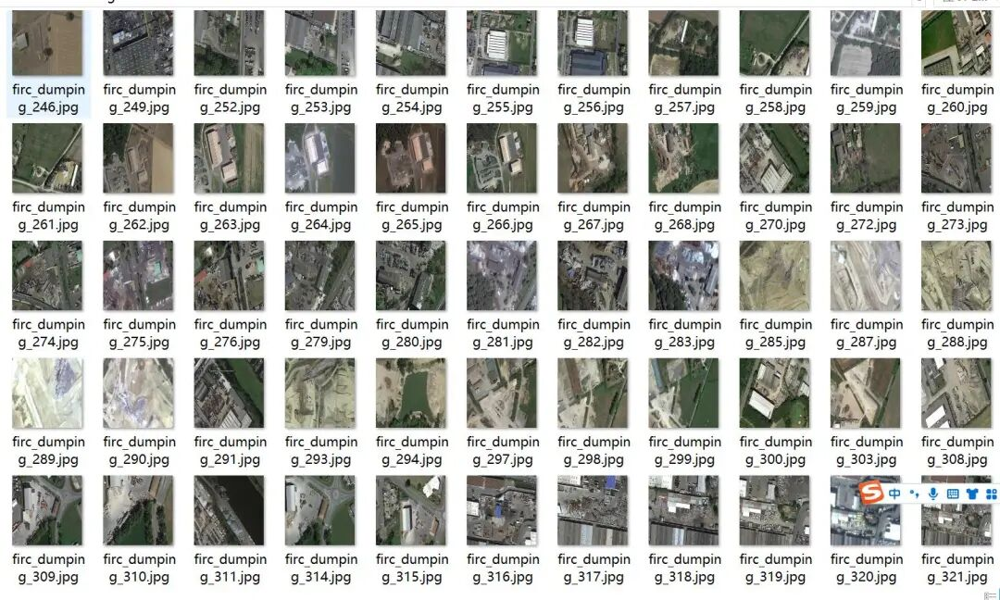
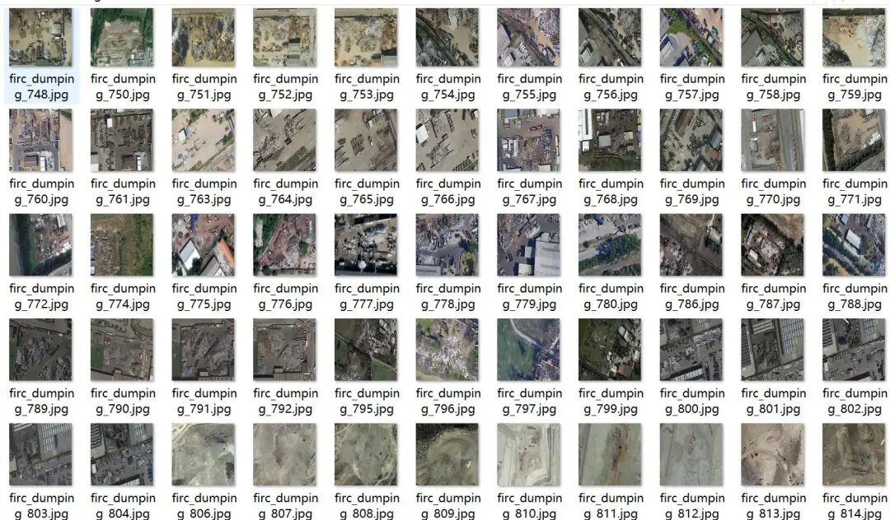
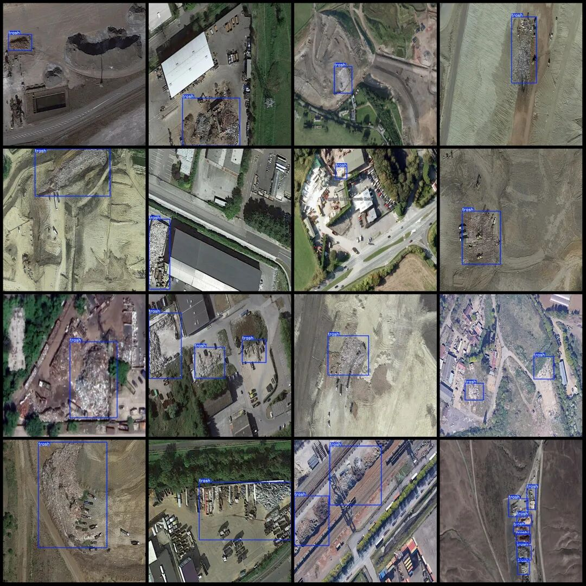

# UAV Perspective Clutter Detection Dataset - VOC+YOLO Format: 712 Images, 1 Category

Dataset format: Pascal VOC format + YOLO format (txt file without split path, only containing jpg images and corresponding VOC format xml files and yolo format txt files)

Number of images (number of jpg files): 712

Number of annotations (number of xml files): 712

Number of annotations (number of txt files): 712

Label category count: 1

Annotation category name (Note that the order of categories in the YOLO format does not correspond to this, but is based on the labels folder's classes.txt): ["trash"]

Number of boxes labeled in each category:

Trash frame count = 1391

Total frame count: 1391

Using labelImg:

Annotation rules: Draw a rectangle around the category.

Important Notice: This dataset is selected from 1501 images in the VOC+YOLO format, focusing on one category. It primarily includes outdoor waste sites (heaps) and waste factories. This dataset is solely for detecting waste heaps.

Image resolution: 1024x1024

Special : This dataset does not guarantee the accuracy of the trained models or weight files.

Image Preview:

Annotation example:

## Payment

Here is a pay link on Stripe ( https://buy.stripe.com/3cs8yP7sY87d0vu9AB ). Please contact me lonlonago@foxmail.com after funding $89, and I will send you a complete data files , thank you!

